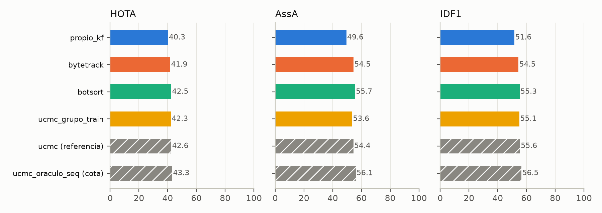
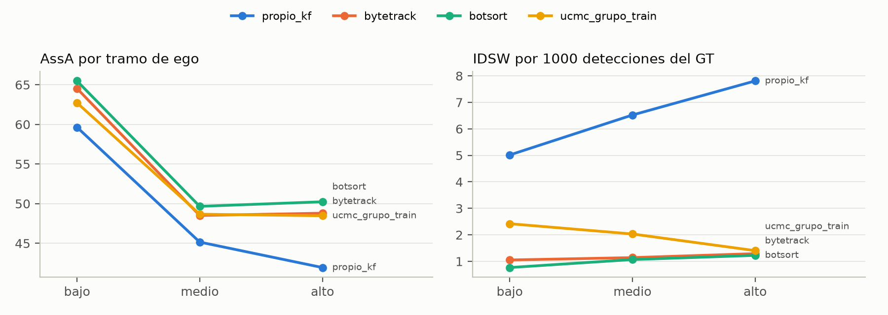
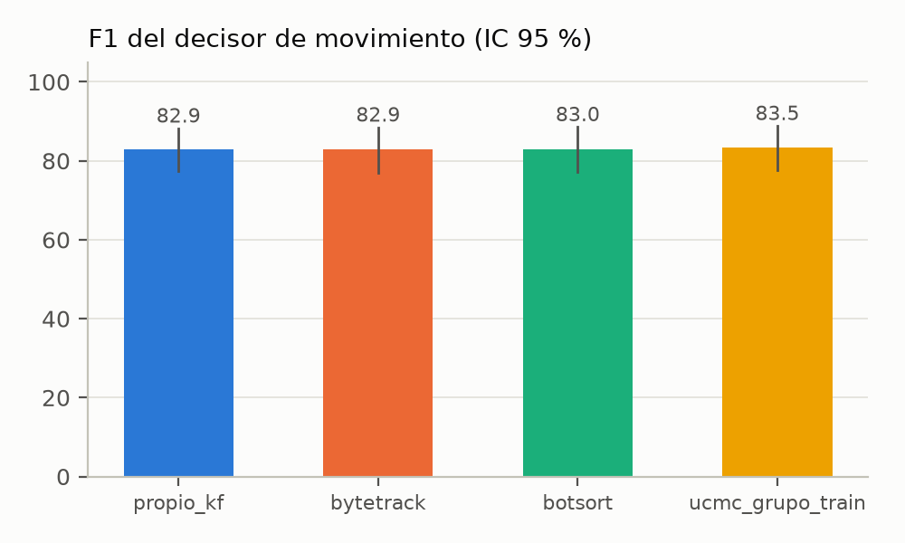

# Resultados del benchmark v1 · trackers MOT para dron con ego-movimiento

Corrida única de test sobre UAVDT-MOT (20 secuencias, 1217 identidades, 337 601 cajas del GT), hecha el
2026-11-27 en el laboratorio con el código de `main` en `37d1bcf`, sin cambios locales. Todo lo que decide el resultado
se congeló antes de correr: umbrales, tramos y exclusiones (congelado 1, D32), correcciones del GT (D33), etiquetas
de movimiento (congelado 2, D34) y cámara de UCMC (D32.4). Plan: [`plan-benchmark-v1.md`](plan-benchmark-v1.md).
Decisiones: [`benchmark/DECISIONS.md`](../benchmark/DECISIONS.md). Vocabulario: [`GLOSSARY.md`](../GLOSSARY.md).

## En una página

1. **Ranking.** BoT-SORT queda primero (HOTA 42.5), en empate técnico con UCMC con cámara por grupo (42.3). Le gana a
   ByteTrack (41.9) por poco pero con IC que excluye 0. Los tres superan claramente a `propio_kf` (40.3), que tiene
   de 3 a 6 veces más cambios de identidad.
2. **P1 · Ego-movimiento.** Los cuatro pierden 5–7 puntos de AssA entre el tramo de ego bajo y el alto, y **ninguno
   pierde significativamente menos que otro**. Compensar el movimiento de cámara, como hacen BoT-SORT y UCMC, no se
   tradujo en más estabilidad de identidad con ego alto.
3. **P2 · Decisor de movimiento.** Igual para los cuatro: F1 ≈ 83 (precisión 99 %, recall 71 %). El tracker no cambia
   la capacidad de decir qué se mueve de verdad.
4. **Cámara de UCMC.** Elegir la cámara por grupo de vuelo en ajuste (42.3) no supera a la calibración automática
   (42.6), y la mejor cámara posible por secuencia (cota, 43.3) apenas suma un punto. Con este detector, conocer la
   cámara vale poco.
5. **El cuello de botella es el detector.** Con el mismo tracker y los mismos umbrales, DetA de 34 en test contra 47 en
   ajuste: los vehículos de test son más
   chicos (caja mediana de 22 px contra 32), y en 6 secuencias el detector casi no ve nada. Las diferencias entre
   trackers (≤ 2.2 HOTA) son pequeñas frente a eso.

---

## 1. Qué se midió

| | |
|---|---|
| Datos | UAVDT-MOT, split oficial: 30 secuencias de ajuste y 20 de test (D18). Vehículos en clase única; regiones ignoradas con la regla del 50 % de área (D8). GT de test con 3 correcciones al oficial (D33) |
| Detector | YOLOv8x entrenado en un subconjunto curado de VisDrone, sin reentrenar (D20). Las mismas detecciones para todos. `conf_high` 0.20 y `conf_low` 0.05, calibrados en ajuste (D32.1) |
| Trackers del ranking | `propio_kf`, ByteTrack, BoT-SORT y UCMC con cámara elegida por grupo de vuelo en ajuste (`ucmc_grupo_train`), todos con sus defaults (D22, D23) |
| Fuera del ranking | `ucmc` con calibración automática (referencia) y `ucmc_oraculo_seq`, la mejor cámara por secuencia mirando el GT de test (cota) |
| Métricas | HOTA, DetA, AssA, IDF1, MOTA e IDSW con TrackEval; combinadas sumando conteos de las 20 secuencias (D14) |
| Estadística | Bootstrap pareado por secuencia, IC 95 %. "Gana" solo si el IC de la diferencia excluye 0; si no, empate técnico (D28) |
| Ego | `ego_px` por frame (homografía, px a 960 de ancho), en tres tramos con los cortes de ajuste: bajo < 0.328 ≤ medio < 1.241 ≤ alto (D26, D32.3) |
| Movimiento real | Etiqueta automática más revisión humana de 623 tracks; acuerdo en la muestra aleatoria de seguros: 76/76 (D27, D34) |

---

## 2. Ranking

| tracker | papel | HOTA | DetA | AssA | IDF1 | MOTA | IDSW | FP | FN |
|---|---|---|---|---|---|---|---|---|---|
| botsort | ranking | **42.5** | 32.8 | **55.7** | **55.3** | **33.6** | **298** | 43 741 | 180 209 |
| ucmc_grupo_train | ranking | 42.3 | **33.7** | 53.6 | 55.1 | 31.8 | 614 | 60 332 | 169 312 |
| bytetrack | ranking | 41.9 | 32.4 | 54.5 | 54.5 | 33.1 | 342 | 42 866 | 182 493 |
| propio_kf | ranking | 40.3 | 33.1 | 49.6 | 51.6 | 28.7 | 1 894 | 71 878 | 166 969 |
| ucmc | referencia | 42.6 | 33.6 | 54.4 | 55.6 | 31.8 | 596 | 60 070 | 169 480 |
| ucmc_oraculo_seq | cota | 43.3 | 33.7 | 56.1 | 56.5 | 31.9 | 558 | 60 156 | 169 238 |

**Comparaciones pareadas** (diferencia A − B, IC 95 %, 20 secuencias):

| A vs B | HOTA | AssA | IDF1 | Veredicto |
|---|---|---|---|---|
| botsort vs bytetrack | +0.7 [0.3, 1.1] | +1.1 [0.4, 2.0] | +0.8 [0.3, 1.5] | **gana BoT-SORT** en las tres |
| botsort vs ucmc_grupo_train | +0.3 [−0.8, 1.5] | +2.0 [0.5, 3.4] | +0.2 [−1.4, 2.1] | empate en HOTA e IDF1; BoT-SORT gana en AssA |
| ucmc_grupo_train vs bytetrack | +0.4 [−1.0, 1.6] | −0.9 [−2.7, 1.1] | +0.7 [−1.5, 2.2] | empate |
| botsort vs propio_kf | +2.2 [0.9, 3.7] | +6.1 [4.1, 8.0] | +3.6 [1.1, 6.2] | **gana BoT-SORT** |
| ucmc_grupo_train vs propio_kf | +1.9 [1.1, 2.9] | +4.0 [2.3, 6.0] | +3.5 [1.9, 5.2] | **gana UCMC** |
| bytetrack vs propio_kf | +1.5 [0.3, 2.9] | +5.0 [3.0, 7.0] | +2.8 [0.4, 5.4] | **gana ByteTrack** |

Lectura:

- **BoT-SORT es el único que nadie supera.** Le gana a ByteTrack y a `propio_kf`, y empata con UCMC en HOTA. En AssA
  también le gana a UCMC.
- **UCMC detecta más** (el DetA más alto, el menor número de FN) pero asocia peor que BoT-SORT: duplica sus IDSW
  (614 contra 298) y tiene ~17 000 FP más.
- **`propio_kf` queda último** por asociación: AssA 49.6, con 1 894 IDSW (3 veces los de UCMC y 6 los de BoT-SORT) y la mayor
  fragmentación (4 427 contra 2 251–3 952). Su DetA es comparable, así que el problema está en mantener la identidad y
  no en detectar.

**Por grupo de vuelo y por luz** (promedio simple por secuencia, descriptivo; los IC no se calcularon por estrato):

| | BoT-SORT | ByteTrack | propio_kf | UCMC grupo | secuencias |
|---|---|---|---|---|---|
| cenital | 57.3 | 55.8 | 55.8 | 57.6 | 4 |
| oblicua_alta | 29.3 | 28.8 | 28.1 | 29.2 | 10 |
| oblicua_baja | 43.0 | 42.5 | 40.0 | 42.6 | 6 |
| día | 36.9 | 36.2 | 36.1 | 37.8 | 12 |
| noche | 47.5 | 46.6 | 41.2 | 44.4 | 5 |
| niebla | 33.2 | 32.8 | 34.9 | 34.2 | 3 |

El orden entre trackers se mantiene en casi todos los estratos; lo que cambia mucho es el nivel. Las tomas oblicuas
altas son las más difíciles, por el tamaño de los vehículos (sección 6). De noche, `propio_kf` es el que más pierde.

**Por protocolo** (HOTA combinado; el ranking oficial es `todos`):

| protocolo | BoT-SORT | ByteTrack | propio_kf | UCMC grupo |
|---|---|---|---|---|
| todos | 42.5 | 41.9 | 40.3 | 42.3 |
| solo móviles | 40.8 | 40.1 | 38.6 | 40.8 |
| solo estáticos | 38.5 | 38.3 | 32.9 | 35.0 |
| móviles de punta a punta (decisor del tracker) | 35.0 | 34.3 | 34.0 | 35.4 |

En vehículos detenidos, `propio_kf` y UCMC caen más que BoT-SORT y ByteTrack.

---

## 3. P1 · ¿Qué tracker mantiene mejor la identidad cuando el dron se mueve?

| tracker | AssA bajo | AssA medio | AssA alto | ΔAssA alto − bajo [IC 95 %] | IDSW/1000 bajo → alto |
|---|---|---|---|---|---|
| botsort | 65.5 | 49.7 | 50.2 | −6.1 [−8.3, −3.5] | 0.8 → 1.2 |
| bytetrack | 64.5 | 48.5 | 48.8 | −5.3 [−8.2, −1.5] | 1.1 → 1.3 |
| ucmc_grupo_train | 62.7 | 48.7 | 48.5 | −7.2 [−10.5, −1.9] | 2.4 → 1.4 |
| propio_kf | 59.6 | 45.2 | 41.9 | −6.3 [−10.0, 1.2] | 5.0 → 7.8 |

Tramos con datos suficientes (D28): bajo con 97 932 cajas del GT y 16 secuencias, medio con 136 775 y 17, alto con
61 216 y 15. El Δ se calcula **dentro de cada secuencia** que tiene frames en ambos tramos (11 secuencias), así que
compara el mismo video consigo mismo.

**¿Alguno pierde menos?** Diferencia pareada de ΔAssA entre trackers (positivo = A pierde menos que B):

| A vs B | dif. ΔAssA [IC 95 %] | Veredicto |
|---|---|---|
| botsort vs ucmc_grupo_train | +1.1 [−3.7, 4.2] | empate |
| bytetrack vs ucmc_grupo_train | +1.9 [−3.2, 4.4] | empate |
| bytetrack vs botsort | +0.8 [−0.7, 3.3] | empate |
| propio_kf vs ucmc_grupo_train | +0.9 [−0.7, 3.8] | empate |
| propio_kf vs bytetrack | −1.0 [−3.7, 5.1] | empate |
| propio_kf vs botsort | −0.2 [−3.8, 6.3] | empate |

Respuesta a P1:

- **El ego-movimiento sí daña la asociación**, en los cuatro trackers por igual: la caída de AssA de bajo a alto
  excluye 0 en tres de ellos y en `propio_kf` casi.
- **Ninguno es significativamente más robusto.** Las seis comparaciones son empates. BoT-SORT (con GMC) y UCMC
  (con proyección al suelo) no pierden menos que ByteTrack, que no compensa nada.
- **La caída se concentra entre bajo y medio**; entre medio y alto el AssA casi no cambia.
- **Descriptivo, sin prueba:** `propio_kf` es el único cuyos IDSW crecen con el ego (5.0 → 7.8 por cada 1000 cajas).
  En los demás se quedan cerca de 1.
- **Frames con homografía no fiable** (1263 frames, casi todos de niebla): HOTA de 12–15 en los cuatro. Ahí falla
  también el detector (DetA ≈ 5), así que no informan sobre asociación.

Los tramos de ego no se asignan al azar: los frames de ego bajo suelen ser vuelo estacionario con escenas más fáciles.
El Δ dentro de cada secuencia controla el video, pero no lo que pasa en él; es una asociación, no un efecto causal
aislado.

---

## 4. P2 · ¿Qué tan bien decide cada tracker qué se mueve de verdad?

| tracker | precisión | recall | F1 [IC 95 %] |
|---|---|---|---|
| ucmc_grupo_train | 99.2 | 72.0 | 83.5 [77.7, 88.8] |
| botsort | 99.3 | 71.2 | 83.0 [77.1, 88.5] |
| propio_kf | 99.2 | 71.2 | 82.9 [77.4, 88.2] |
| bytetrack | 99.3 | 71.1 | 82.9 [76.9, 88.4] |

- **Los cuatro son equivalentes:** los IC se traslapan casi por completo.
- **El decisor casi nunca marca como móvil algo quieto** (precisión del 99 %), pero se pierde ~29 % de los frames en
  movimiento. Una de las causas es que necesita tiempo para acumular desplazamiento: la mediana de latencia para
  "encenderse" va de 0.6 s (ByteTrack) a 0.9 s (`propio_kf`), y detecta el 59–65 % de los arranques.
- No hay transiciones móvil → detenido en el GT de test (tras la revisión, cada track quedó entero como móvil o
  quieto), así que no se mide la latencia de apagado.

---

## 5. Secundarios

**Valor de conocer la cámara (UCMC):**

| versión | cómo se elige la cámara | HOTA | AssA | IDF1 |
|---|---|---|---|---|
| `ucmc` (referencia) | automática, sin datos | 42.6 | 54.4 | 55.6 |
| `ucmc_grupo_train` (ranking) | mejor de la rejilla por grupo de vuelo en ajuste (D32.4) | 42.3 | 53.6 | 55.1 |
| `ucmc_oraculo_seq` (cota) | mejor de la rejilla por secuencia, mirando el GT de test | 43.3 | 56.1 | 56.5 |

Conocer el tipo de vuelo no mejora a la calibración automática, y ni la cámara perfecta para cada secuencia agrega
más de ~1 HOTA. Es descriptivo (sin IC), pero el margen es tan chico que, con este detector, la telemetría de cámara no
movería el ranking. El criterio para elegir cámara sin GT no pasó la validación en ajuste (ρ = −0.15, D32.5).

**Costo** (mediana de ms por frame del tracker, sin detector ni ego, misma máquina; relativo, no absoluto):
ByteTrack 18.7, UCMC 18.8–19.0, `propio_kf` 19.3 y BoT-SORT 22.0. Las diferencias son menores al 20 %.

---

## 6. El detector, la mayor limitación

| | ajuste | test |
|---|---|---|
| DetA de UCMC con la cámara de su grupo (promedio por secuencia, mismos umbrales) | 47.2 | 34.4 |
| DetA del detector solo en `conf_high` (ajuste) / de los trackers (test, combinado) | 54.0 | 32.4–33.7 |
| Tamaño mediano de la caja del GT | 31.9 px | 22.4 px |
| Cajas del GT menores de 16 px | 9.6 % | 21.2 % |

Seis secuencias de test tienen DetA < 20 con cualquier tracker y suman el 36 % de las cajas del GT de test:

| secuencia | grupo, luz | caja mediana | recall del detector | DetA (BoT-SORT) |
|---|---|---|---|---|
| M0602 | oblicua_alta, día | 12 px | 0.3 % | 0.3 |
| M0208 | oblicua_alta, día | 19 px | 3.1 % | 2.9 |
| M0601 | oblicua_alta, día | 16 px | 3.7 % | 3.7 |
| M1004 | oblicua_alta, niebla | 17 px | 10.3 % | 10.0 |
| M1401 | oblicua_baja, día | 20 px | 13.6 % | 12.7 |
| M0701 | cenital, niebla | 19 px | 20.9 % | 19.2 |

M0701 sola aporta el 22 % de las cajas del GT de test. La regla de exclusión (D25) se decidió por estrato en ajuste,
donde ningún grupo ni iluminación bajó de 20, así que estas secuencias **se quedan** en el ranking, como se congeló.
Afectan a los cuatro por igual, porque todos usan las mismas detecciones: bajan el nivel, pero no cambian quién asocia
mejor lo que sí se detecta.

La causa probable es la resolución: el detector corre a 640 px sobre frames de 1024, y un vehículo de 12–16 px
queda en 7–10 px. Un detector a resolución completa o entrenado con UAVDT es lo primero a cambiar en una v2.

---

## 7. Limitaciones

- **Detector débil en objetos chicos** (sección 6). Las conclusiones son sobre asociación con este detector; con uno
  mejor, las diferencias entre trackers podrían crecer o cambiar de orden.
- **20 secuencias.** Los IC son anchos: diferencias menores de ~1 HOTA no se pueden resolver. Que no haya diferencia
  entre trackers en P1 es "no detectada", no "demostrada igual".
- **Ego natural, no controlado.** UAVDT no trae ego-movimiento extremo: el P90 es 2.7 px por frame y el tramo alto
  arranca en 1.24. El "alto" de este benchmark es moderado; no se probó vuelo agresivo (D26).
- **GT de UAVDT con errores.** Se corrigieron los encontrados en la revisión de test (D33). En ajuste quedan ~8
  tracks sospechosos sin revisar, además de autos estacionados sin anotar en ambos splits.
- **Etiqueta de movimiento.** Automática y corregida por una sola persona. Acuerdo del 100 % en la muestra de
  seguros, pero sin medir el acuerdo entre dos anotadores.
- **Defaults sin ajustar** (D22). Ningún tracker se optimizó; con ajuste, el orden podría cambiar.
- **Cámara de UCMC aproximada.** hfov fijo de 74° (A7) y una rejilla limitada de pitch × altura (D17).

---

## 8. Reproducir

- **Código:** `main` en `37d1bcf` (corrida) y [`guia-laboratorio-final.md`](guia-laboratorio-final.md) (pasos).
- **Insumos versionados:** `benchmark/secuencias.yaml`, `benchmark/adaptadores/correcciones_uavdt.yaml` y
  `benchmark/revision/decisiones/`.
- **Salidas de la evaluación:** [`resultados-v1/eval/`](resultados-v1/eval/), con métricas por secuencia y protocolo,
  comparaciones, tramos de ego, decisor y latencias.
- **Figuras y tablas:** [`resultados-v1/reporte/`](resultados-v1/reporte/), con `run.json` (versiones y configuración)
  y `seleccion_camara.csv`.
- Las figuras se regeneran sin volver a correr trackers con `python bench.py reporte --run v1`, desde `eval/`.
