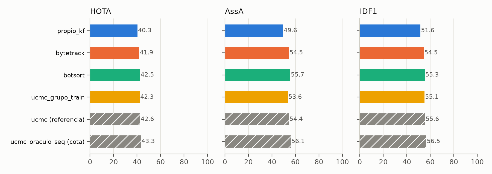
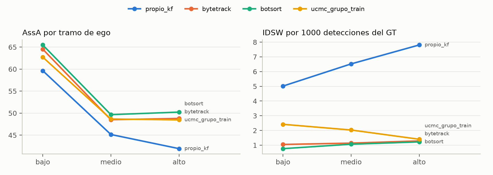
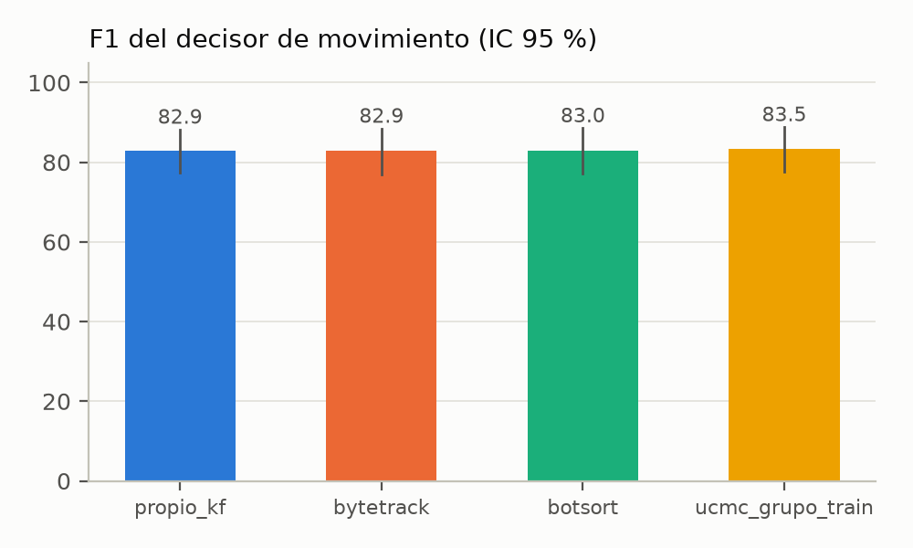

# Resultados · run `v1`

Generado por `bench.py reporte` desde `eval/`. Solo secuencias de test; combinados por suma de conteos (D14). Ranking = una entrada por tracker (D23); referencia y cota no compiten.

## Ranking

| tracker | papel | HOTA | DetA | AssA | IDF1 | MOTA | IDSW | Frag |
|---|---|---|---|---|---|---|---|---|
| propio_kf | ranking | 40.3 | 33.1 | 49.6 | 51.6 | 28.7 | 1894 | 4427 |
| bytetrack | ranking | 41.9 | 32.4 | 54.5 | 54.5 | 33.1 | 342 | 2421 |
| botsort | ranking | 42.5 | 32.8 | 55.7 | 55.3 | 33.6 | 298 | 2251 |
| ucmc_grupo_train | ranking | 42.3 | 33.7 | 53.6 | 55.1 | 31.8 | 614 | 3952 |
| ucmc | referencia | 42.6 | 33.6 | 54.4 | 55.6 | 31.8 | 596 | 3929 |
| ucmc_oraculo_seq | cota | 43.3 | 33.7 | 56.1 | 56.5 | 31.9 | 558 | 3957 |

### HOTA por grupo (promedio simple por secuencia, descriptivo)

| grupo | botsort | bytetrack | propio_kf | ucmc_grupo_train | secuencias |
|---|---|---|---|---|---|
| cenital | 57.3 | 55.8 | 55.8 | 57.6 | 4 |
| oblicua_alta | 29.3 | 28.8 | 28.1 | 29.2 | 10 |
| oblicua_baja | 43.0 | 42.5 | 40.0 | 42.6 | 6 |

### HOTA por luz (promedio simple por secuencia, descriptivo)

| luz | botsort | bytetrack | propio_kf | ucmc_grupo_train | secuencias |
|---|---|---|---|---|---|
| dia | 36.9 | 36.2 | 36.1 | 37.8 | 12 |
| niebla | 33.2 | 32.8 | 34.9 | 34.2 | 3 |
| noche | 47.5 | 46.6 | 41.2 | 44.4 | 5 |

## Comparaciones pareadas (IC 95 %, bootstrap de secuencias)

Un tracker gana solo si el IC de la diferencia excluye 0; si no, es empate técnico (D28).

| A | B | metrica | delta | ic95_bajo | ic95_alto | gana_en | n_secuencias | veredicto |
|---|---|---|---|---|---|---|---|---|
| propio_kf | bytetrack | HOTA | -1.5 | -2.9 | -0.3 | 8 | 20 | gana bytetrack |
| propio_kf | bytetrack | AssA | -5.0 | -7.0 | -3.0 | 4 | 20 | gana bytetrack |
| propio_kf | bytetrack | IDF1 | -2.8 | -5.4 | -0.4 | 7 | 20 | gana bytetrack |
| propio_kf | botsort | HOTA | -2.2 | -3.7 | -0.9 | 6 | 20 | gana botsort |
| propio_kf | botsort | AssA | -6.1 | -8.0 | -4.1 | 4 | 20 | gana botsort |
| propio_kf | botsort | IDF1 | -3.6 | -6.2 | -1.1 | 7 | 20 | gana botsort |
| propio_kf | ucmc_grupo_train | HOTA | -1.9 | -2.9 | -1.1 | 3 | 20 | gana ucmc_grupo_train |
| propio_kf | ucmc_grupo_train | AssA | -4.0 | -6.0 | -2.3 | 4 | 20 | gana ucmc_grupo_train |
| propio_kf | ucmc_grupo_train | IDF1 | -3.5 | -5.2 | -1.9 | 5 | 20 | gana ucmc_grupo_train |
| bytetrack | botsort | HOTA | -0.7 | -1.1 | -0.3 | 4 | 20 | gana botsort |
| bytetrack | botsort | AssA | -1.1 | -2.0 | -0.4 | 5 | 20 | gana botsort |
| bytetrack | botsort | IDF1 | -0.8 | -1.5 | -0.3 | 3 | 20 | gana botsort |
| bytetrack | ucmc_grupo_train | HOTA | -0.4 | -1.6 | 1.0 | 6 | 20 | empate |
| bytetrack | ucmc_grupo_train | AssA | 0.9 | -1.1 | 2.7 | 9 | 20 | empate |
| bytetrack | ucmc_grupo_train | IDF1 | -0.7 | -2.2 | 1.5 | 8 | 20 | empate |
| botsort | ucmc_grupo_train | HOTA | 0.3 | -0.8 | 1.5 | 11 | 20 | empate |
| botsort | ucmc_grupo_train | AssA | 2.0 | 0.5 | 3.4 | 13 | 20 | gana botsort |
| botsort | ucmc_grupo_train | IDF1 | 0.2 | -1.4 | 2.1 | 10 | 20 | empate |

## P1 · Estabilidad de identidad por tramo de ego

| tracker | bin | n_frames | n_gt_dets | secuencias | HOTA | AssA | IDSW | IDSW_por_1000 | indicativo |
|---|---|---|---|---|---|---|---|---|---|
| propio_kf | H_no_fiable | 1263 | 41678 | 9 | 12.3 | 31.0 | 33 | 0.8 | False |
| propio_kf | alto | 5420 | 61216 | 15 | 34.7 | 41.9 | 478 | 7.8 | False |
| propio_kf | bajo | 3735 | 97932 | 16 | 50.7 | 59.6 | 491 | 5.0 | False |
| propio_kf | medio | 6120 | 136775 | 17 | 40.0 | 45.2 | 892 | 6.5 | False |
| bytetrack | H_no_fiable | 1263 | 41678 | 9 | 14.0 | 46.2 | 4 | 0.1 | False |
| bytetrack | alto | 5420 | 61216 | 15 | 37.9 | 48.8 | 79 | 1.3 | False |
| bytetrack | bajo | 3735 | 97932 | 16 | 52.6 | 64.5 | 103 | 1.1 | False |
| bytetrack | medio | 6120 | 136775 | 17 | 40.4 | 48.5 | 156 | 1.1 | False |
| botsort | H_no_fiable | 1263 | 41678 | 9 | 14.7 | 49.3 | 2 | 0.0 | False |
| botsort | alto | 5420 | 61216 | 15 | 38.7 | 50.2 | 75 | 1.2 | False |
| botsort | bajo | 3735 | 97932 | 16 | 53.2 | 65.5 | 75 | 0.8 | False |
| botsort | medio | 6120 | 136775 | 17 | 41.2 | 49.7 | 146 | 1.1 | False |
| ucmc_grupo_train | H_no_fiable | 1263 | 41678 | 9 | 13.6 | 39.3 | 13 | 0.3 | False |
| ucmc_grupo_train | alto | 5420 | 61216 | 15 | 38.0 | 48.5 | 86 | 1.4 | False |
| ucmc_grupo_train | bajo | 3735 | 97932 | 16 | 52.3 | 62.7 | 237 | 2.4 | False |
| ucmc_grupo_train | medio | 6120 | 136775 | 17 | 41.7 | 48.7 | 278 | 2.0 | False |

### ΔAssA (alto − bajo), IC 95 %

| tracker | bajo | alto | dAssA | IC_inf | IC_sup | secuencias |
|---|---|---|---|---|---|---|
| propio_kf | bajo | alto | -6.3 | -10.0 | 1.2 | 11 |
| bytetrack | bajo | alto | -5.3 | -8.2 | -1.5 | 11 |
| botsort | bajo | alto | -6.1 | -8.3 | -3.5 | 11 |
| ucmc_grupo_train | bajo | alto | -7.2 | -10.5 | -1.9 | 11 |

### ¿Qué tracker pierde menos? Diferencia pareada de ΔAssA (A − B), IC 95 %

Positivo = A pierde menos AssA que B entre el tramo bajo y el alto. Gana solo si el IC excluye 0.

| A | B | dif_dAssA | IC_inf | IC_sup | secuencias | veredicto |
|---|---|---|---|---|---|---|
| propio_kf | bytetrack | -1.0 | -3.7 | 5.1 | 11 | empate |
| propio_kf | botsort | -0.2 | -3.8 | 6.3 | 11 | empate |
| propio_kf | ucmc_grupo_train | 0.9 | -0.7 | 3.8 | 11 | empate |
| bytetrack | botsort | 0.8 | -0.7 | 3.3 | 11 | empate |
| bytetrack | ucmc_grupo_train | 1.9 | -3.2 | 4.4 | 11 | empate |
| botsort | ucmc_grupo_train | 1.1 | -3.7 | 4.2 | 11 | empate |

## P2 · Decisor de movimiento contra movimiento real

| tracker | precision | recall | F1 | IC_inf | IC_sup | n_frames_emparejados | secuencias |
|---|---|---|---|---|---|---|---|
| propio_kf | 99.2 | 71.2 | 82.9 | 77.4 | 88.2 | 168148 | 20 |
| bytetrack | 99.3 | 71.1 | 82.9 | 76.9 | 88.4 | 152817 | 20 |
| botsort | 99.3 | 71.2 | 83.0 | 77.1 | 88.5 | 155037 | 20 |
| ucmc_grupo_train | 99.2 | 72.0 | 83.5 | 77.7 | 88.8 | 165791 | 20 |

### Latencias del decisor (descriptivo)

| tracker | tipo | tramos | pct_detectado | mediana_s |
|---|---|---|---|---|
| botsort | apagado | 0 | — | — |
| botsort | encendido | 1447 | 59.36 | 0.67 |
| bytetrack | apagado | 0 | — | — |
| bytetrack | encendido | 1447 | 59.46 | 0.60 |
| propio_kf | apagado | 0 | — | — |
| propio_kf | encendido | 1447 | 64.62 | 0.93 |
| ucmc_grupo_train | apagado | 0 | — | — |
| ucmc_grupo_train | encendido | 1447 | 60.59 | 0.70 |

## Secundario · Valor de conocer la cámara (UCMC)

Automática (referencia) → elegida por grupo en ajuste (ranking) → mejor por secuencia (cota).

| tracker | secuencia | HOTA | AssA | IDF1 |
|---|---|---|---|---|
| ucmc_grupo_train | COMBINADO | 42.3 | 53.6 | 55.1 |
| ucmc | COMBINADO_REFERENCIA | 42.6 | 54.4 | 55.6 |
| ucmc_oraculo_seq | COMBINADO_COTA | 43.3 | 56.1 | 56.5 |

## Secundario · Costo (ms por frame, relativo; misma máquina)

| tracker | total_ms |
|---|---|
| botsort | 22.02 |
| bytetrack | 18.70 |
| propio_kf | 19.26 |
| ucmc | 19.03 |
| ucmc_grupo_train | 18.82 |
| ucmc_oraculo_seq | 18.79 |
